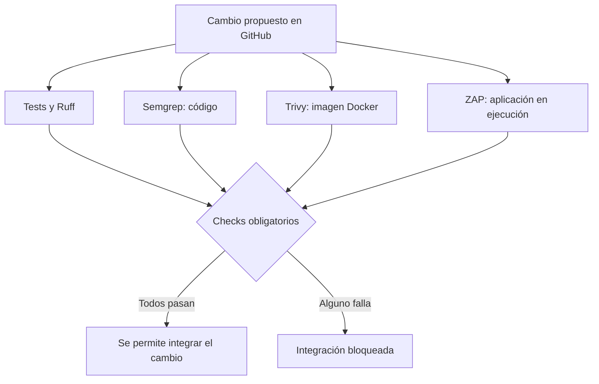

# Application Security Pipeline: explicación completa

## 1. Para qué sirve el proyecto

Application Security Pipeline demuestra cómo desarrollar una aplicación que maneja
datos privados y establecer comprobaciones automáticas para evitar que los cambios
introduzcan fallos de seguridad.

Tiene dos partes conectadas:

1. Una API de documentos privados, donde se implementan los controles de seguridad.
2. Un pipeline que comprueba el funcionamiento y la seguridad cada vez que cambia
   el código.

El caso de uso es sencillo: Alice y Bob utilizan la aplicación para guardar notas
privadas. Cada persona debe poder gestionar sus documentos y tener restringido el
acceso a los documentos ajenos. Un administrador dispone de permisos adicionales
definidos expresamente.

Este escenario permite estudiar un problema habitual en aplicaciones reales:
proteger información perteneciente a distintas personas dentro de un mismo servicio.

El resultado permite explicar un proceso completo:

**Riesgo identificado → control implementado → prueba que detecta el fallo →
corrección → comprobación automática antes de integrar cambios.**

## 2. Qué hace la aplicación

La API gestiona documentos de texto. Cada documento contiene:

| Campo | Significado |
|---|---|
| `id` | Identificador UUID del documento. |
| `owner_id` | Identificador de su propietario. |
| `title` | Título del documento. |
| `content` | Contenido de texto. |

Los usuarios tienen un identificador, un nombre único, un hash de contraseña y un
rol: `user` o `admin`.

Un usuario normal puede crear, listar, consultar, editar y borrar sus documentos.
La aplicación recibe peticiones HTTP y devuelve respuestas JSON.

Por ejemplo, Alice puede crear un documento mediante esta petición conceptual:

```http
POST /documents
Content-Type: application/json
X-CSRFToken: <token-de-la-sesion>
Cookie: appsec_session=<cookie-de-alice>
```

```json
{
  "title": "Notas de una reunión",
  "content": "Contenido privado de Alice"
}
```

El servidor obtiene el propietario a partir de la sesión de Alice y guarda el
documento en PostgreSQL. El cliente no puede elegir otro propietario enviando
`owner_id`: ese campo no forma parte de las entradas permitidas.

El administrador puede consultar y borrar documentos ajenos mediante las rutas
`/admin`. La edición corresponde al propietario, también cuando quien realiza
la petición tiene rol administrador.

Los usuarios y sus roles se crean mediante una CLI de gestión. No hay registro
público ni un endpoint que permita solicitar privilegios administrativos.

### Rutas principales

| Método y ruta | Función |
|---|---|
| `GET /health` | Comprobar que la aplicación puede conectar con PostgreSQL. |
| `GET /auth/csrf` | Obtener el token CSRF asociado a una sesión. |
| `POST /auth/login` | Autenticar un usuario. |
| `POST /auth/logout` | Cerrar su sesión. |
| `GET /auth/me` | Consultar la identidad y el rol actuales. |
| `GET /documents` | Listar documentos propios, con paginación. |
| `POST /documents` | Crear un documento para el usuario autenticado. |
| `GET /documents/<uuid>` | Consultar un documento propio. |
| `PATCH /documents/<uuid>` | Modificar el título o contenido de un documento propio. |
| `DELETE /documents/<uuid>` | Borrar un documento propio. |
| `GET /admin/documents` | Listar documentos como administrador. |
| `GET /admin/documents/<uuid>` | Consultar cualquier documento como administrador. |
| `DELETE /admin/documents/<uuid>` | Borrar cualquier documento como administrador. |

Los modelos están en [models.py](../appsec_pipeline/models.py). Las operaciones
normales están en [documents.py](../appsec_pipeline/documents.py), y las
administrativas en [admin.py](../appsec_pipeline/admin.py).

## 3. Autenticación y autorización

Son dos decisiones distintas:

| Decisión | Pregunta que responde | Ejemplo |
|---|---|---|
| Autenticación | ¿Quién eres? | La sesión identifica a Alice. |
| Autorización | ¿Qué puedes hacer? | Alice puede consultar un documento porque le pertenece. |

Una persona puede iniciar sesión correctamente y seguir intentando acceder a
información ajena. Por eso comprobar únicamente que existe una sesión sería
insuficiente.

Supongamos que Bob descubre el identificador de un documento de Alice y realiza:

```http
GET /documents/<uuid-del-documento-de-alice>
```

La aplicación busca un documento que cumpla las dos condiciones simultáneamente:

```python
Document.id == document_id
Document.owner_id == current_user.id
```

Como el propietario es Alice y la sesión corresponde a Bob, la consulta no
devuelve ese documento. La API responde con `404`, igual que para un documento
inexistente. Así evita confirmar a Bob la existencia del documento ajeno.

Este control evita un fallo conocido como **IDOR o BOLA**: acceder a un objeto
ajeno utilizando su identificador. Se aplica también a modificación y borrado.
Los listados filtran los documentos por propietario.

El UUID dificulta la enumeración, pero la autorización depende de la comprobación
de propietario. Conocer el UUID nunca debe conceder acceso por sí mismo.

Las rutas administrativas comprueban el rol cargado desde PostgreSQL. El servidor
rechaza campos como `role` o `owner_id` enviados en los cuerpos de las operaciones
normales. Un usuario no puede convertirse en administrador añadiendo esos campos.

## 4. Contraseñas, sesiones y CSRF

### Almacenamiento de contraseñas

Las contraseñas se almacenan mediante scrypt con una sal aleatoria. Al iniciar
sesión, la aplicación verifica la contraseña recibida contra el hash guardado.
El método configurado es `scrypt:32768:8:3`.

El login devuelve el mismo error para un usuario inexistente y una contraseña
incorrecta. También realiza una comprobación de hash para usuarios inexistentes,
reduciendo diferencias de comportamiento sin prometer tiempo constante completo.

La CLI exige contraseñas de entre 15 y 128 caracteres al crear usuarios, o puede
generar una contraseña aleatoria. El código está en
[passwords.py](../appsec_pipeline/passwords.py) y [cli.py](../appsec_pipeline/cli.py).

### Sesiones

Flask-Login gestiona la identidad durante la sesión. El cliente conserva una
cookie firmada que permite reconocer las peticiones posteriores.

La sesión tiene una duración de 30 minutos, no se renueva con cada petición
ordinaria y no contiene documentos, roles ni contraseñas. El rol se obtiene de
la base de datos. Al iniciar sesión correctamente se borra el estado anterior.

La configuración de cookies incluye:

- `HttpOnly`: impide leer directamente la cookie desde JavaScript.
- `SameSite=Lax`: restringe su envío en determinados contextos entre sitios.
- `Secure` en producción: limita su envío a HTTPS.

La cookie está firmada, no cifrada. Su firma permite detectar manipulaciones.
Una copia robada puede reutilizarse hasta caducar: no existe un almacén servidor
de revocación de sesiones. Esta limitación está documentada.

### Protección CSRF

Las cookies pueden acompañar automáticamente a peticiones del navegador. Un
sitio malicioso podría intentar aprovechar esa sesión para provocar acciones
que la persona no ha solicitado.

La protección CSRF exige un token asociado a la sesión. El cliente lo obtiene
mediante `/auth/csrf` y lo envía en la cabecera `X-CSRFToken` al realizar operaciones
que cambian estado, incluidos login y logout. Flask-WTF comprueba su validez.

Después del login es necesario obtener un token nuevo, porque se ha renovado el
estado de sesión. Los tests mantienen CSRF activado para comprobar este flujo.

La autenticación está en [auth.py](../appsec_pipeline/auth.py).

## 5. Validación, errores y protección de los datos

La API valida los campos permitidos, sus tipos y sus límites:

- Título no vacío tras recortar espacios y con un máximo de 200 caracteres.
- Contenido de texto entre 0 y 50.000 caracteres.
- Cuerpo HTTP máximo de 256 KiB.
- Listados paginados, con un máximo de 100 resultados por página.
- Rechazo de campos desconocidos y caracteres nulos.

Las consultas de SQLAlchemy utilizan parámetros. Los documentos se devuelven
como JSON, sin convertir su contenido en HTML ejecutable.

Los errores tienen un formato JSON uniforme y no incluyen SQL, contraseñas ni
detalles internos. Entre las respuestas habituales están:

| Código | Uso |
|---|---|
| `400` | Entrada inválida o fallo de CSRF. |
| `401` | Autenticación necesaria o credenciales incorrectas. |
| `403` | Falta de permiso administrativo. |
| `404` | Recurso inexistente o documento ajeno en rutas normales. |
| `413` | Cuerpo de petición demasiado grande. |
| `415` | Tipo de contenido incorrecto. |

CSRF se comprueba antes de la autorización en las mutaciones. Por ello una
petición anónima sin token puede recibir `400`; con un token válido recibe `401`.
Ambas situaciones rechazan la operación.

También se añaden cabeceras como `Cache-Control: no-store` y
`X-Content-Type-Options: nosniff`. Los borrados administrativos registran el
identificador del actor y del documento, sin registrar su contenido.

La validación está en [validation.py](../appsec_pipeline/validation.py), y la
configuración y gestión de errores en
[la factoría de aplicación](../appsec_pipeline/__init__.py).

## 6. Arquitectura y entorno reproducible

El recorrido principal de una petición es:

```text
Cliente HTTP
    ↓
Gunicorn + Flask
    ↓
SQLAlchemy
    ↓
PostgreSQL
```

| Componente | Función en el proyecto |
|---|---|
| Flask | Recibir peticiones y aplicar la lógica de la API. |
| Gunicorn | Ejecutar la aplicación como servidor WSGI. |
| SQLAlchemy | Definir modelos y construir consultas a la base de datos. |
| PostgreSQL | Almacenar usuarios y documentos. |
| Alembic | Crear y versionar la estructura de tablas. |
| Docker Compose | Coordinar el arranque de los servicios. |

Compose espera a PostgreSQL, aplica la migración y arranca la API. No se crean
tablas improvisadamente mediante `create_all()` al arrancar el servidor.

Hay utilidades para generar secretos locales y crear datos ficticios de desarrollo.
El seed crea usuarios normales, un administrador y documentos. Genera contraseñas
aleatorias, las muestra solo al crear los usuarios y conserva los datos existentes
en ejecuciones posteriores. Solo está disponible en desarrollo.

La imagen ejecuta la API con UID 10001. En Compose, el contenedor tiene filesystem
de solo lectura, almacenamiento temporal en `/tmp`, capacidades eliminadas y
restricción de adquisición de nuevos privilegios.

PostgreSQL no publica un puerto al exterior. En desarrollo, la aplicación utiliza
un rol de base de datos sin superusuario, creación de bases ni creación de roles.
Ese rol sigue siendo propietario de las tablas y se comparte con las migraciones;
separar permisos DDL y DML sería una evolución posterior.

`uv.lock` fija las versiones y hashes de las dependencias Python. Las imágenes
Docker están fijadas por digest y las acciones de GitHub por SHA.

El arranque y los ejemplos ejecutables se encuentran en el [README](../README.md).

## 7. Qué comprueban los tests

Se han construido 86 casos de prueba, incluyendo variantes de un mismo
comportamiento. El número de casos no representa un número de vulnerabilidades.

La suite comprueba, entre otras cosas:

- Inicio y cierre de sesión.
- Rechazo de peticiones sin autenticar.
- Creación, consulta, edición y borrado por el propietario.
- Rechazo de lectura, modificación y borrado entre usuarios.
- Permisos administrativos.
- Intentos de enviar `role=admin` o elegir otro propietario.
- CSRF ausente, inválido o perteneciente a otra sesión.
- Entradas incorrectas, límites y errores genéricos.
- Cookies manipuladas y sesiones caducadas.
- Migraciones y comandos de gestión.

Los tests utilizan PostgreSQL real en un entorno separado. Cada ejecución crea
un esquema aislado y cada test revierte sus cambios, incluso cuando el código de
aplicación hace `commit`.

Por ejemplo, la prueba de aislamiento hace que Bob intente modificar el documento
de Alice y después comprueba que el contenido original sigue intacto. Se verifica
tanto la respuesta de rechazo como la ausencia de efectos sobre los datos.

Los tests están en [tests/](../tests/). Además hay cuatro pruebas de política en
[security/tests/](../security/tests/), que verifican umbrales, informes defectuosos,
autenticación incompleta y excepciones.

## 8. Qué es el pipeline y cuándo se ejecuta

El pipeline es el conjunto de comprobaciones automáticas que GitHub Actions
ejecuta cuando cambia el código. Hay workflows para tests y para seguridad,
activados por push, pull request o ejecución manual.

Los controles de seguridad se ejecutan en paralelo:



| Herramienta | Qué comprueba |
|---|---|
| pytest | Comportamiento funcional y decisiones de autorización. |
| Ruff | Errores y consistencia del código Python. |
| Semgrep | Patrones de código potencialmente peligrosos. |
| Trivy | Vulnerabilidades conocidas en los paquetes de la imagen. |
| ZAP | Comportamiento HTTP de la aplicación mientras está ejecutándose. |

Los workflows están en [tests.yml](../.github/workflows/tests.yml) y
[security.yml](../.github/workflows/security.yml).

La integración continua comprueba los cambios. El despliegue automático a
producción queda fuera del alcance de este proyecto.

## 9. Qué analiza cada escáner

### Semgrep: análisis del código

Semgrep utiliza seis reglas locales revisables que detectan:

1. Evaluación dinámica mediante `eval` o `exec`.
2. Deserialización mediante pickle.
3. Ejecución de procesos con `shell=True`.
4. Debug habilitado mediante el patrón configurado.
5. Determinados patrones de desactivación de CSRF.
6. SQL construido con cadenas formateadas en el patrón configurado.

Su cobertura está acotada a esas reglas. Un resultado limpio no acredita que se
hayan buscado todas las clases de vulnerabilidades.

La configuración está en [semgrep.json](../security/semgrep.json).

### Trivy: análisis de la imagen

Trivy analiza la imagen runtime construida desde el Dockerfile. Comprueba tanto
los paquetes del sistema operativo como las dependencias Python.

Los resultados dependen de la imagen y de la base de avisos disponible en la fecha
del análisis. Una imagen que hoy cumple el umbral puede dejar de cumplirlo al
publicarse nuevos avisos.

### ZAP: análisis de la aplicación ejecutándose

ZAP utiliza un entorno temporal separado de los datos de desarrollo. El proceso:

1. Arranca la API, PostgreSQL y el proxy de ZAP.
2. Genera un usuario y una contraseña para esa ejecución.
3. Obtiene un token CSRF e inicia sesión.
4. Crea un documento ficticio.
5. Comprueba `401` anónimo y `200` autenticado en identidad y documento.
6. Configura la reutilización de cookie y CSRF para el destino temporal.
7. Realiza análisis activo y espera al análisis pasivo.
8. Cuenta respuestas autenticadas de documentos asociadas a mensajes del análisis activo.
9. Comprueba de nuevo la identidad, exporta el informe y retira el entorno.

Así se evita presentar como análisis autenticado una ejecución que solo haya
visitado rutas públicas. Las credenciales y cookies se redactan del informe.

El análisis tiene un presupuesto de cinco minutos y utiliza un usuario normal.
La autorización completa de roles y operaciones se verifica con pytest; ZAP no
acredita cobertura exhaustiva de todas las funciones de la API.

La implementación está en [scan.py](../security/scan.py), y el alcance detallado
en [SECURITY_PIPELINE.md](SECURITY_PIPELINE.md).

## 10. Políticas de bloqueo y protección de main

Los resultados tienen consecuencias sobre la integración del código:

| Situación | Resultado |
|---|---|
| Fallan tests, Ruff o la infraestructura necesaria | Bloqueo. |
| Semgrep detecta un resultado ERROR/HIGH/CRITICAL | Bloqueo. |
| Trivy detecta High o Critical, tenga o no parche | Bloqueo. |
| ZAP detecta High | Bloqueo. |
| Falta un informe, es inválido o no cumple las comprobaciones de cobertura | Bloqueo. |
| Una excepción está caducada o mal definida | Bloqueo. |

Los avisos Medium/Low permanecen en los informes para su revisión.

Existe un formato para excepciones con escáner, identificador del hallazgo,
destino exacto, motivo, responsable y fecha de revisión. No permite exenciones
globales mediante comodines. En la versión verificada la lista está vacía.

Los informes se conservan como artefactos de GitHub Actions durante 14 días,
incluidos los que contienen hallazgos bloqueantes.

`main` exige una pull request, una rama actualizada y estos cuatro checks:

- `PostgreSQL tests`.
- `Security (semgrep)`.
- `Security (trivy)`.
- `Security (zap)`.

La protección se aplica también al administrador y prohíbe force push y borrado.
Para este repositorio de un único mantenedor se configuraron cero aprobaciones
externas obligatorias, conservando el PR y los checks.

Las políticas están en [policy.py](../security/policy.py), las excepciones en
[exceptions.json](../security/exceptions.json) y la configuración de protección en
[branch-protection.json](../security/branch-protection.json).

## 11. Un problema real detectado y corregido

Trivy detectó inicialmente vulnerabilidades en la imagen Debian. Tras una primera
actualización y el parche de zlib, seguían apareciendo 47 hallazgos High/Critical,
correspondientes a 11 CVE únicos repetidos en varios paquetes.

La remediación consistió en:

1. Adoptar una base Alpine más pequeña, fijada por digest.
2. Retirar SQLite y su extensión nativa de Python, porque la API utiliza PostgreSQL.
3. Actualizar Kerberos a `1.22.3-r0`, versión corregida indicada por Trivy.
4. Conservar el inventario de paquetes, los umbrales y las comprobaciones.
5. Repetir los tests y los análisis.

La retirada de SQLite fue deliberada: su versión seguía instalada aunque el
informe de Alpine no mostrase los avisos vistos en Debian. Se eliminaron el
paquete y su extensión, en lugar de interpretar esa diferencia entre informes
como una corrección.

El cambio de glibc a musl se comprobó con las dependencias bloqueadas y sus ruedas
musllinux, los tests contra PostgreSQL y ZAP autenticado.

La última ejecución verificada de la corrección terminó con cero High/Critical
en Trivy. Los avisos Medium/Low permanecieron visibles. No se añadieron excepciones
ni exclusiones de CVE para conseguir ese resultado.

La corrección se integró mediante una PR con los checks en verde. Evidencias:

- [PR #1: corrección de la imagen](https://github.com/mariaig01/application-security-pipeline/pull/1).
- [Tests del commit integrado](https://github.com/mariaig01/application-security-pipeline/actions/runs/43461824812).
- [Análisis de seguridad del commit integrado](https://github.com/mariaig01/application-security-pipeline/actions/runs/43461824819).

Estos resultados corresponden a la verificación del 2026-11-13. No garantizan
que futuras bases de avisos devuelvan los mismos resultados.

## 12. Modelo de amenazas y demostraciones

El modelo STRIDE recoge activos, actores, flujos de datos y límites de confianza.
Organiza amenazas de suplantación, alteración, repudio, divulgación, denegación
de servicio y elevación de privilegios.

En el proyecto se documentaron once amenazas y se relacionaron con controles,
pruebas y riesgos residuales. Por ejemplo:

| Riesgo | Control | Evidencia |
|---|---|---|
| Bob accede al documento de Alice | Consulta filtrada por propietario | Test de aislamiento entre usuarios. |
| Un usuario intenta asignarse rol admin | Campos permitidos y rol gestionado por CLI | Tests de escalada y permisos administrativos. |
| Un sitio externo provoca una mutación | Token CSRF ligado a la sesión | Tests de token ausente, inválido y ajeno. |
| Una imagen contiene paquetes vulnerables | Trivy y umbral de bloqueo | Informes y remediación de la imagen. |
| Un análisis falla y parece correcto | Política que rechaza informes incompletos | Tests de política. |

Hay dos demostraciones aisladas:

- [idor.py](../demos/idor.py): una consulta vulnerable permite a Bob leer el documento
  de Alice; la consulta corregida supera la misma comprobación de aislamiento.
- [unsafe.py](../demos/unsafe.py): contiene un `eval` que Semgrep debe detectar y
  bloquear. Esta fixture se analiza por separado y no debe ejecutarse.

Las demostraciones quedan fuera de la imagen de aplicación. No existe un
interruptor para convertir la API normal en una aplicación vulnerable.

El modelo completo está en [THREAT_MODEL.md](THREAT_MODEL.md), y la checklist
de revisión en [CODE_REVIEW_CHECKLIST.md](CODE_REVIEW_CHECKLIST.md).

## 13. Qué demuestra el proyecto y cuáles son sus límites

El proyecto permite demostrar tareas de Application Security y DevSecOps:
identificar un riesgo, implementar un control, comprobarlo automáticamente,
investigar resultados y exigir evidencia antes de integrar cambios.

El alcance es una API pequeña y un entorno reproducible de aprendizaje. Sus
limitaciones están documentadas:

- No incorpora MFA, rate limiting ni cuotas de almacenamiento por usuario.
- Una copia robada de una cookie no se revoca globalmente al hacer logout.
- Los documentos tienen controles de acceso, pero no cifrado propio del contenido en reposo.
- La terminación TLS productiva requiere infraestructura externa.
- Los registros de borrado administrativo no constituyen una auditoría duradera completa.
- El rol de base de datos de aplicación comparte propiedad de tablas con migraciones.
- Semgrep y ZAP tienen la cobertura concreta descrita en este documento.
- La imagen final se verificó en Linux AMD64; no se probó ARM64.

Los checks correctos acreditan que se han cumplido las comprobaciones y umbrales
definidos para esa ejecución. El mantenimiento posterior incluye actualizar
dependencias, revisar nuevos avisos y conservar las pruebas de seguridad.
