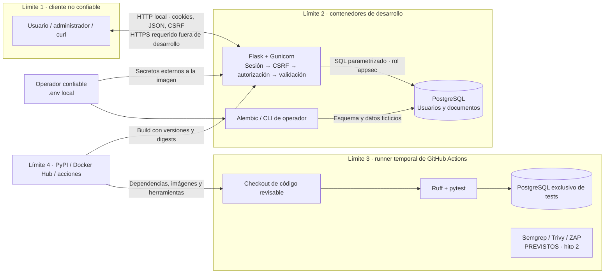

# Modelo de amenazas STRIDE — hito 1

Fecha: 2026-09-22. Alcance: API de texto privado, CLI, PostgreSQL, contenedores y
workflow de tests. No hay frontend, adjuntos, integraciones salientes ni registro
público. Los controles futuros se indican como pendientes; este documento no es
un informe de escáner ni una certificación.

## Activos y actores

Activos: contenido/títulos privados, asociación documento-propietario, credenciales
con hash, identidad y rol, clave de firma, cookies/CSRF, disponibilidad, integridad
del esquema/código/imagen y evidencias del pipeline.

Actores: visitante anónimo, usuario autenticado, administrador de aplicación,
operador con acceso a CLI/Docker, colaborador que propone un PR, proveedor de
dependencias. Un administrador puede leer y borrar todos los documentos por
decisión explícita del producto; no puede editar contenido ajeno. El operador
con acceso a Docker/DB está en una zona de confianza superior.

## Flujos y límites de confianza

Flujos sensibles: credenciales al login; token CSRF y cookie entre cliente/API;
rol cargado de DB por petición; consultas filtradas por propietario; operaciones
globales explícitas de administrador; migraciones/seed desde CLI. El cliente no
puede elegir propietario ni rol. Las bases de desarrollo y tests no comparten red,
volumen ni datos. CI no utiliza credenciales de desarrollo ni producción.

## Amenazas, controles y evidencia

| ID / STRIDE | Escenario y riesgo | Implementado en hito 1 | Prueba / evidencia | Pendiente o riesgo residual |
|---|---|---|---|---|
| T01 · S (suplantación) | Robo de contraseñas de DB o adivinación de credenciales. | Hash scrypt con sal, contraseñas CLI de 15–128 caracteres, secretos aleatorios, errores de login genéricos. | `test_secure_password_storage`, `test_invalid_credentials_are_generic`, tests de CLI. | Rate limiting, MFA y detección de ataques de login; el hash no evita fuerza bruta online. |
| T02 · T/I (alteración/divulgación) | BOLA/IDOR: Bob conoce el UUID de Alice y opera sobre él. | Filtro simultáneo por ID y propietario en lectura, PATCH y DELETE; listados propios; 404 sin confirmar existencia. | `test_cross_user_isolation_read_write_delete_and_list` comprueba rechazo y preservación del contenido. | Los UUID dificultan enumerar, pero no se consideran autorización. PostgreSQL RLS no está implementado. |
| T03 · T (alteración) | Un sitio externo fuerza operaciones usando cookies, incluido login CSRF. | Flask-WTF global, token ligado a sesión, cookies SameSite, nueva sesión tras login, HTTPS Referer estricto. | `test_login_requires_csrf`, `test_document_mutations_require_csrf`, `test_csrf_token_is_bound_to_session`, `test_admin_delete_requires_csrf`. | Cualquier futuro cliente web deberá manejar el token; ZAP autenticado en hito 2. |
| T04 · E (elevación) | Un usuario envía `role=admin` o el `owner_id` de otra persona. | Lista permitida de campos; propietario derivado de sesión; rol solo desde DB/CLI; rutas administrativas exigen rol. | `test_api_cannot_grant_admin`, `test_normal_user_cannot_administer`, tests de validación y seed sin elevación. | CLI y operadores siguen siendo confiables; el acceso a Docker equivale a un privilegio elevado. |
| T05 · T/I (inyección) | Texto controlado por atacante se convierte en SQL o HTML. | SQLAlchemy parametriza valores; contenido se devuelve como JSON con `nosniff` y CSP; sin renderizado HTML. | `test_text_is_returned_as_json_without_html_interpretation`. | Un futuro frontend deberá codificar al renderizar. No se promete que un único payload cubra toda inyección. |
| T06 · I (divulgación) | Errores, cachés, logs o repositorio revelan documentos/secretos. | Errores JSON genéricos, `no-store`, logs sin cuerpo/contraseña/SQL, `.env` ignorado, contexto Docker por lista permitida, serializers sin hash. | `test_unexpected_error_is_generic`, `test_database_error_is_generic`, pruebas de cabeceras/login y revisión del build. | TLS/cifrado en reposo y gestión externa de secretos; salida de CLI generada se custodia como secreto. |
| T07 · D (denegación) | Cuerpos enormes, páginas ilimitadas, scrypt concurrente o crecimiento de DB. | 256 KiB por petición; 200/50.000 caracteres; páginas ≤100; timeout de Gunicorn. | `test_malformed_json_content_type_and_body_size`, `test_document_boundary_lengths`, tests de paginación. | No hay cuotas, rate limiting, prueba de carga ni garantía frente a DoS distribuido. |
| T08 · R (repudio) | Un administrador borra contenido y niega haberlo hecho. | Log de borrado con ID del actor y documento, sin contenido. | `test_admin_can_read_and_delete_but_cannot_edit_other_documents` observa el evento. | No es auditoría completa: falta lectura administrativa, registro duradero, integridad, retención y atomicidad entre commit/log. |
| T09 · S/I (sesión robada) | Robo, manipulación o replay de cookie firmada. | Firma de biblioteca, HttpOnly, SameSite, Secure en producción, 30 minutos, sin remember-me, estado previo eliminado al login. | `test_tampered_cookie_rejected`, `test_session_expiration`, `test_cookie_flags_and_expiry`, `test_login_identity_logout`. | Cookie firmada no cifrada; logout no revoca copias robadas. Un almacén servidor/token de revocación sería una evolución. |
| T10 · T/E (cadena de suministro) | Dependencia, imagen o acción comprometida o vulnerable. | `uv.lock` con hashes, imágenes por digest, acción por SHA, permisos CI mínimos, runtime sin root ni herramientas de tests. | Construcción congelada y workflow revisable. | Fijar no elimina CVE: Semgrep/Trivy y política de actualización en hitos 2/3. Ningún hallazgo de escáner declarado todavía. |
| T11 · E (base de datos) | Una inyección o compromiso de API obtiene privilegios de infraestructura. | Rol de aplicación sin superusuario/CREATEDB/CREATEROLE; DB sin puerto publicado; contraseña bootstrap distinta y ausente del contenedor API. | Comprobación operativa del rol y configuración Compose. | App y Alembic comparten propietario de tablas; separar rol runtime DML y rol de migración DDL, y limitar CONNECT entre bases, queda pendiente. |

## Prioridades y evolución

T02, T03 y T04 tienen prioridad inicial: el propósito del servicio es conservar la
confidencialidad y autorización de documentos. Cada cambio de ruta debe mantener
sus pruebas negativas. Los tests no prueban ausencia universal de vulnerabilidades.

Antes de exposición pública: TLS real, secretos gestionados, restricciones de
hosts, límites de abuso y separación de privilegios DB. Hito 2 añade análisis y
cobertura autenticada. Hito 3 fija bloqueos, excepciones con fecha de revisión,
rulesets y demos aisladas. No se introducirá un flag `VULNERABLE=true` en esta API.

Fuentes: [Flask security](https://flask.palletsprojects.com/en/stable/web-security/),
[Flask-Login](https://flask-login.readthedocs.io/en/latest/),
[Flask-WTF CSRF](https://flask-wtf.readthedocs.io/en/latest/csrf/),
[OWASP Password Storage](https://cheatsheetseries.owasp.org/cheatsheets/Password_Storage_Cheat_Sheet.html),
[SQLAlchemy: transacciones externas para tests](https://docs.sqlalchemy.org/en/20/orm/session_transaction.html#joining-a-session-into-an-external-transaction-such-as-for-test-suites).
